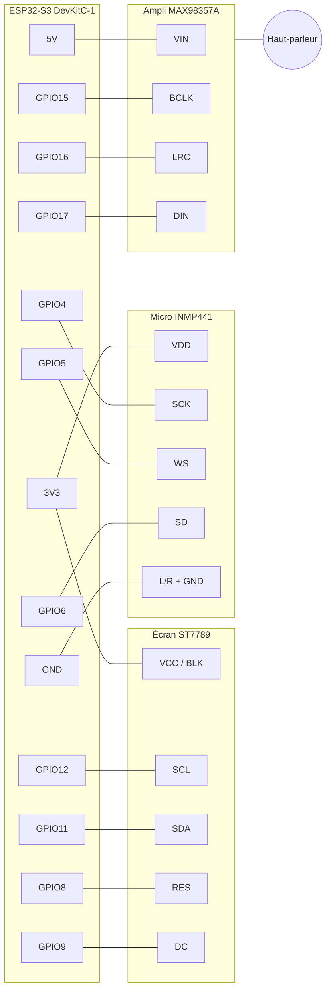

# Matériel nécessaire et schéma de branchement

Je ne donne pas de prix (je ne peux pas les vérifier). Les références viennent de la liste choisie pour ce projet ; **rien n'a été testé physiquement**.

## 1. Liste du matériel

| # | Composant | Qté | Remarque |
|---|---|---|---|
| 1 | Carte **ESP32-S3 DevKitC-1** (de préférence version N8R2 ou N16R8 avec PSRAM) | 1 | Le firmware n'a pas besoin de PSRAM mais elle donne de la marge. Si ta carte a une PSRAM *octal* (N8R8, N16R8), évite les GPIO 35, 36, 37 (non utilisés ici). |
| 2 | Écran **IPS 1,3" 240x240 ST7789**, module 7 broches (GND VCC SCL SDA RES DC BLK) | 1 | C'est le type visible sur ta photo (GMT130-V1.0). |
| 3 | Micro **INMP441** (I2S, breakout) | 1 | Micro MEMS numérique. |
| 4 | Ampli **MAX98357A** (I2S, breakout) | 1 | Ampli classe D, sortie mono. |
| 5 | **Haut-parleur** 4 à 8 Ω, 1 à 3 W, petit (28 à 40 mm) | 1 | À brancher sur les bornes de sortie du MAX98357A. |
| 6 | Câble **USB-C** (données + alimentation) | 1 | Pour flasher et alimenter. |
| 7 | Fils Dupont (femelle-femelle ou soudure) + breadboard pour les tests | 1 lot | |
| 8 | *(Option)* Batterie **LiPo 3,7 V** + module de charge **TP4056 avec protection** | 1 | Voir section « Batterie » ci-dessous. |
| 9 | *(Option)* **Convertisseur boost 5 V** (type MT3608 réglé à 5 V) | 1 | Pour alimenter l'ESP32 et l'ampli depuis la LiPo. |
| 10 | *(Option)* Interrupteur, boîtier imprimé 3D | | Boîtier : à dessiner/imprimer selon tes dimensions. |

Outils : fer à souder (recommandé pour un montage définitif), ordinateur avec PlatformIO.

## 2. Tableau de branchement (broches par défaut du projet)

**Écran ST7789 (SPI)**

| Écran | ESP32-S3 |
|---|---|
| VCC | 3V3 |
| GND | GND |
| SCL (SCK) | GPIO 12 |
| SDA (MOSI) | GPIO 11 |
| RES | GPIO 8 |
| DC | GPIO 9 |
| BLK (rétroéclairage) | 3V3 (toujours allumé) |

**Micro INMP441 (I2S, port 0)**

| INMP441 | ESP32-S3 |
|---|---|
| VDD | 3V3 |
| GND | GND |
| SCK | GPIO 4 |
| WS | GPIO 5 |
| SD | GPIO 6 |
| L/R | **GND** (canal gauche, requis par le firmware) |

**Ampli MAX98357A (I2S, port 1)**

| MAX98357A | ESP32-S3 |
|---|---|
| VIN | 5V (broche 5V de la carte) |
| GND | GND |
| BCLK | GPIO 15 |
| LRC | GPIO 16 |
| DIN | GPIO 17 |
| SD, GAIN | laisser non connectés (ampli actif, gain par défaut) |
| Sortie + / − | haut-parleur |

**Bouton** : le bouton BOOT de la carte (GPIO 0) sert de bouton « parler » forcé. Il n'y a rien à câbler.

## 3. Schéma



Version texte :

```
                    ESP32-S3 DevKitC-1
                 ┌──────────────────────┐
  Écran ST7789   │                      │   Micro INMP441
  VCC,BLK ───────┤ 3V3            GPIO4 ├─────── SCK
  SCL ───────────┤ GPIO12         GPIO5 ├─────── WS
  SDA ───────────┤ GPIO11         GPIO6 ├─────── SD
  RES ───────────┤ GPIO8                │        VDD ── 3V3
  DC  ───────────┤ GPIO9                │        L/R, GND ── GND
  GND ───────────┤ GND                  │
                 │                      │   Ampli MAX98357A
                 │ 5V ──────────────────┼─────── VIN
                 │ GPIO15 ──────────────┼─────── BCLK
                 │ GPIO16 ──────────────┼─────── LRC
                 │ GPIO17 ──────────────┼─────── DIN
                 │ GND ─────────────────┼─────── GND ── (+/-) ── Haut-parleur
                 └──────────────────────┘
        Tous les GND sont reliés ensemble.
```

## 4. Batterie (option) : points d'attention

- **Fait établi** : une LiPo ne se branche pas directement sur les broches 3V3/5V de la carte. Elle passe par un module de charge/protection (TP4056 avec protection ou équivalent).
- **Mon hypothèse** (non vérifiée) : la solution la plus simple est LiPo → TP4056 → boost 5 V → broche 5V de la carte, qui alimente aussi l'ampli (le MAX98357A tire des pics de courant quand le volume est fort). À valider avec la fiche technique de ta carte et de tes modules.
- Pense à un interrupteur et à ne jamais charger la LiPo sans protection.
- Certaines cartes ESP32-S3 ont un connecteur batterie avec charge intégrée : cela peut remplacer le TP4056, selon le modèle.

## 5. Conseils de montage

1. Teste d'abord sur breadboard, avec l'alimentation par USB.
2. Fils courts entre l'ESP32 et le micro/ampli : les fils longs ajoutent du bruit sur les signaux I2S.
3. Éloigne le micro du haut-parleur dans le boîtier pour limiter l'écho (le firmware n'écoute pas pendant que le robot parle, mais les vibrations de boîtier peuvent quand même gêner).
4. Après flash, ouvre le moniteur série (`pio device monitor`) : tu verras `rms=... seuil=...` ; ajuste `VAD_MIN_RMS` dans `config.h` pour que la détection de voix se déclenche en parlant mais pas avec le bruit de la pièce.
